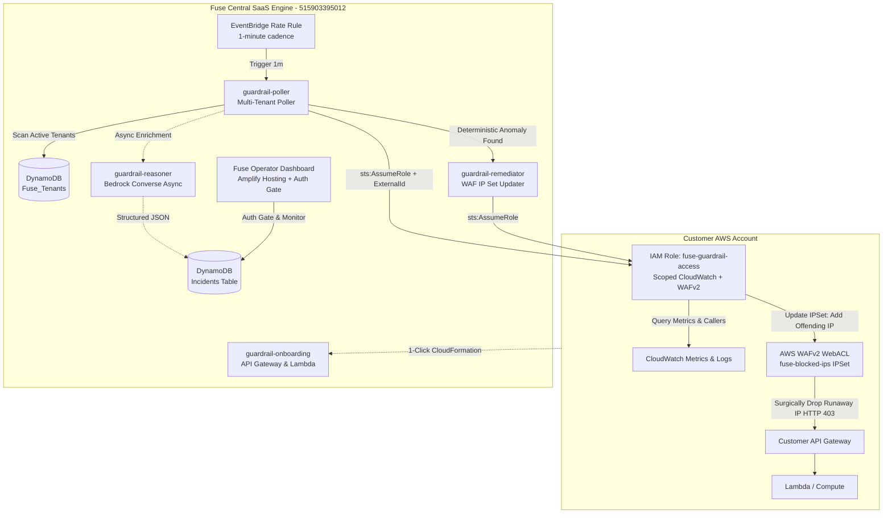

# Fuse: Autonomous Cloud Cost Guardrail & WAF Circuit Breaker

> **An autonomous, context-aware circuit breaker and surgical WAF guardrail for serverless APIs powered by Amazon Bedrock, EventBridge, DynamoDB, AWS WAFv2, and Cross-Account IAM.**  
> Created by **Pranjul Chaurasiya** ([@pranjul_chaurasiya](https://github.com/Pranjulchaurasiya))

[Live Platform](https://main.d1hndpgpwb40h8.amplifyapp.com) &bull; [Customer Onboarding](https://main.d1hndpgpwb40h8.amplifyapp.com/onboarding.html) &bull; [Demo Walkthrough](https://youtu.be/UWzPBdO63ek) &bull; [Architecture Spec](ARCHITECTURE.md) &bull; [AWS Builder Center Post](docs/blog-post.md)

[-blue?style=for-the-badge&logo=awsamplify)](https://main.d1hndpgpwb40h8.amplifyapp.com)
[](https://github.com/Pranjulchaurasiya/fuse/actions/workflows/deploy.yml)
[](https://aws.amazon.com/cognito/)
[-orange?style=for-the-badge&logo=amazonwebservices)](https://main.d1hndpgpwb40h8.amplifyapp.com)
[](https://aws.amazon.com/bedrock/)
[](https://aws.amazon.com/waf/)

---

## Live Platform & Verification
- **Live Landing Page & Console**: [https://main.d1hndpgpwb40h8.amplifyapp.com](https://main.d1hndpgpwb40h8.amplifyapp.com) *(Secured with Amazon Cognito Cryptographic JWT Auth & Zero-Secrets Architecture)*
- **Customer Onboarding (Live)**: [https://main.d1hndpgpwb40h8.amplifyapp.com/onboarding.html](https://main.d1hndpgpwb40h8.amplifyapp.com/onboarding.html) &mdash; 1-click Cross-Account IAM CloudFormation onboarding without sharing any AWS credentials.
- **Product Walkthrough (2m 58s)**: [https://youtu.be/UWzPBdO63ek](https://youtu.be/UWzPBdO63ek) &mdash; full end-to-end demonstration featuring live anomaly detection, human-in-the-loop approval, and surgical WAF mitigation.
- **Every AWS resource ID in this README is real and independently checkable** &mdash; see Section 05 for exact names/IDs
- **AWS Builder Center Post**: [docs/blog-post.md](docs/blog-post.md)

[](https://youtu.be/UWzPBdO63ek)
*Click above to watch the complete 3-minute end-to-end video demonstration on YouTube.*

### How It Works

**Customer Onboarding** (zero credential sharing):
```
Customer Signs Up → Generates ExternalId → 1-Click CloudFormation Stack in Customer AWS → Assumes Cross-Account Role
```

**Runtime** (fully autonomous once running):
```
Observe → Reason & Classify → Isolate (WAF IP Block) → Auto-Recover (Cooldown)
```

* **Onboard**: Customer launches `fuse-cross-account-role.yaml` in their AWS account, granting scoped read (CloudWatch) and write (WAFv2 IP Set) permissions to Fuse's account (`515903395012`).
* **Observe**: EventBridge triggers `guardrail-poller` every 60s, querying tenant CloudWatch metrics and log streams out-of-band.
* **Reason**: Anomaly Z-score & caller dominance tests run deterministically; Bedrock provides asynchronous, structured narrative enrichment.
* **Isolate**: Offending IP addresses are dynamically added to a regional AWS WAFv2 IP Set, surgically dropping runaway loops with HTTP 403 while allowing traffic from other caller IPs to proceed uninterrupted. Suspected Corporate NAT gateways and enterprise Safe Harbor IPs are routed to the Approval Queue without blocking.
* **Auto-Recover**: Stale IP blocks automatically expire and unblock after a configurable cooldown window (default: 15 min).

---

## 01 / The Problem

Serverless auto-scaling hides runaway loops. An infinite client retry loop, exponential backoff without jitter, unhandled 500 error cascades, or recursive LLM agent loops can generate thousands of requests per second, accumulating catastrophic AWS bills before human operators wake up.

Traditional CloudWatch static alarms (*"if requests > 100/min then alarm"*) create an impossible operational tradeoff:
* **False Positives**: During a legitimate marketing launch or flash sale with 1,000 unique buyers, a static alarm trips and throttles paying customers.
* **Collateral Damage (The Corporate NAT Problem)**: If 500 employees behind a single corporate egress NAT generate a volume surge, naive IP blocks take down an entire enterprise client.
* **Slow Remediation**: By the time an on-call engineer wakes up, reads an SNS email, and manually updates stage throttling, the damage is already done.

### Strategy vs. Production Outcome

| Defense Strategy | Legitimate Flash Surge (1,000 callers) | Recursive Runaway Loop (1 caller, 1 endpoint) | Corporate NAT Gateway (500 users, 1 IP, diverse paths) | Production Outcome |
| :--- | :---: | :---: | :---: | :--- |
| **No Guardrail** | Normal operation | Thousands billed in minutes | Thousands billed in minutes | Unbounded financial liability |
| **Naive Static Alarm** (`Count > 100`) | **Tripped & Throttled (False Outage)** | Throttled (after alert delay) | Throttled (False Outage) | Kills revenue during marketing launches |
| **Global Stage Throttle** | Preserves system | Kills ALL users (Collateral Damage) | Kills ALL users (Collateral Damage) | Total outage for paying customers |
| **Naive IP WAF Block** | Passed | Offending IP Blocked | **Blocked (All 500 Enterprise Users Cut Off)** | High collateral damage on shared proxies |
| **Fuse (Cognitive WAF Breaker)** | **Passed (Baseline preserved)** | **Offending IP Blocked in WAF** | **Bypasses WAF Block & Queues for Approval** | **Surgical isolation + zero NAT collateral damage** |

**Fuse** solves this by evaluating multi-dimensional context: **caller diversity**, **URI path entropy**, **traffic deltas**, and **deployment heartbeats** with deterministic statistical analysis and Amazon Bedrock, dropping runaway caller IPs at the **AWS WAFv2** edge in seconds without disrupting legitimate traffic.

---

## 02 / System Architecture

### Multi-Tenant SaaS & WAF Edge Topology


---

## 03 / Key Architectural Pillars

### 1. Zero Credential Sharing (Cross-Account IAM Roles)
Customers never provide IAM access keys. Onboarding generates a unique `ExternalId` and a 1-click CloudFormation template (`infra/cloudformation/fuse-cross-account-role.yaml`). Fuse accesses tenant telemetry via short-lived, 15-minute `sts:AssumeRole` sessions strictly scoped to read CloudWatch and update WAF IP Sets.

### 2. Surgical WAF Isolation (Targeted Edge Containment)
Unlike crude stage throttles (`RateLimit -> 0`) that shut down entire APIs and punish paying customers during an incident, Fuse acts surgically:
* Identifies offending caller IPs responsible for runaway traffic loops
* Appends offending IPs (`/32`) into AWS WAFv2 IP Sets (`fuse-blocked-ips`)
* Returns immediate **HTTP 403 Forbidden** to the bad actor while preserving **HTTP 200** flow for non-offending caller IPs.

### 3. Dual-Tier Corporate NAT & Enterprise Safe Harbor Protection
Surgical IP blocking on shared corporate networks can accidentally take down hundreds of users sharing a single gateway IP. Fuse introduces a dual-tier protection mechanism:
* **Tier 1 (Safe Harbor Allowlist)**: Configurable `SAFE_HARBOR_IPS` environment parameter accepts CIDR subnets (e.g. `198.51.100.0/24`) and IP addresses for enterprise partners, VPNs, or internal microservices. Spikes from these IPs are classified as `SAFE_HARBOR_EXEMPT` and bypass automated WAF blocking.
* **Tier 2 (URI Path Cardinality Entropy Check)**: A runaway code loop hammers **1 single endpoint** continuously (e.g., `GET /items`). In contrast, 500 corporate employees behind a single NAT gateway access **$\ge 3$ distinct endpoints** (e.g., `/login`, `/catalog`, `/cart`, `/checkout`).
* **Non-Destructive Routing**: When an anomaly matches Safe Harbor or exhibits high path entropy ($\ge 3$ paths), Fuse classifies it as `NAT_TRAFFIC_SUSPECTED`, leaves the WAF open, and routes the incident to the DynamoDB `ApprovalQueue` with action `PENDING_APPROVAL` for operator review.

### 4. Automated Cooldown & Self-Healing (Auto-Recovery)
Incidents are not permanent locks. The poller monitors active IP blocks and automatically purges expired IP addresses after a configurable cooldown window (`RECOVERY_WINDOW_MINUTES`, default: 15 min), safely returning the system to normal operations.

### 5. Deterministic Statistical Gating with Bedrock Enrichment
To ensure sub-second response times and eliminate hallucination risk on fast paths:
* **Detection & Remediation**: Run purely deterministically in Python via Z-scores, standard deviations, and caller dominance metrics.
* **Amazon Bedrock (Nova Micro)**: Invoked asynchronously for non-blocking contextual narrative summaries and audit logs without impeding remediation latency.

### 6. Real-Time Channel Alerting (Slack & Discord)
Circuit breaker trips and unblock recovery events dispatch formatted webhook alerts in sub-second time:
* **Rich Embeds**: Posts target IP addresses (`/32`), API resources, incident IDs, and measured anomaly rationale (*"Dominant runaway caller 203.0.113.42 drove 96/100 requests (96.0%)"*).
* **Multi-Tenant Routing**: Customers configure their own incoming webhook URL during onboarding, allowing incident notifications to post directly into their organization's internal `#devops` or `#alerts` channels.
* **Non-Blocking Delivery**: Webhook dispatch is asynchronous with strict 3-second timeouts, guaranteeing zero disruption to the primary WAF mitigation path.

### 7. Zero-Secrets Cryptographic Auth & Human-in-the-Loop (HITL) Gate
* **Amazon Cognito User Pools**: Operator dashboard authentication uses Amazon Cognito (`ap-south-1_09wo36fcc`) with short-lived JWT ID tokens validated by API Gateway's `CognitoAuthorizer`. Zero static API keys or cloud credentials reside in browser storage.
* **Human-in-the-Loop Approval Queue**: For ambiguous anomalies or suspected corporate NAT traffic, operators can review telemetry and trigger one-click approval or manual unblock via the control API (`/incidents/{incident_id}/approve`).

### 8. Layered Defense-in-Depth (Native WAF + Bedrock Poller)
Fuse uses a two-tier strategy to eliminate detection lag:
* **Tier 1 (Instant Edge Flood Cap)**: Native AWS WAF Rate-Based Rule (`fuse-emergency-burst-cap`) drops violent floods (>500 reqs/5min per IP) at the regional edge within seconds.
* **Tier 2 (Cognitive Poller + Bedrock Sentinel)**: Inspects subtle, low-frequency runaway retry loops (90 reqs/min) that bypass static rate rules over a 15-minute statistical window and orchestrates automated self-healing.

### 9. End-to-End Time-to-Block & Propagation Breakdown

| Phase | Subsystem | Latency / Window | Operational Optimization |
| :--- | :--- | :--- | :--- |
| **Edge Flood Buffer** | AWS WAF Rate Rule | **< 1s inline** | Catches extreme spikes (>500 req/5min) before metrics register. |
| **Metric Ingestion** | CloudWatch API GW `Count` | **~60s aggregation** | EventBridge polls `get_metric_data` on 1-min cadence (0ms runtime API tax). |
| **Log Extraction** | CloudWatch Logs Filter | **150ms – 400ms** | Scoped `startTime` (window-bound), strict `filterPattern="DEMO_API_REQUEST"`, and a bounded `limit=100` prevent timeouts on massive log groups. |
| **Z-Score Engine** | Sentinel Poller (Python) | **< 50ms** | Pure deterministic Python math (numpy/math stdlib) evaluates standard deviation and caller entropy. |
| **WAF IP Set Update** | Remediator (`update_ip_set`) | **~250ms** | Appends caller `/32` CIDR using optimistic locking (`LockToken`). |
| **WAF Propagation** | AWS Regional WAF Edge | **~2s – 4s** | Global/regional sync drops subsequent packets with **HTTP 403**. |

**Total Out-of-Band Time-to-Block:** **~62 to 65 seconds** (*illustrative estimate:* caps a runaway ~500 req/s serverless compute loop to ~$1-$3 within ~1 min, assuming standard API Gateway + Lambda execution pricing, compared to unbounded accumulation over hours before static budget alert notifications) while maintaining **0ms added latency** on healthy API requests.

### 10. Threat Model & Operational Boundaries
* **60s CloudWatch Metric Lag**: CloudWatch publishes API Gateway metric data in 1-minute aggregations. The Tier-1 native rate rule provides immediate edge buffering during the aggregation interval.
* **Log Ingestion Tuning**: Querying CloudWatch Logs uses strict server-side timestamp filtering (`startTime`) and pattern gating (`filterPattern`) to prevent Lambda timeout during high-volume spikes.
* **Shared NAT/VPN IP Boundaries**: Mitigated via URI path cardinality entropy checks ($\ge 3$ distinct endpoints) and CIDR Safe Harbor allowlisting. High-entropy candidate IPs are queued for human approval rather than automatically blocked.

---

## 04 / Live Verification & Test Scripts

Fuse verification is split between deterministic edge isolation unit suites and end-to-end traffic generators in `ap-south-1`:

| Script | Command | Purpose & Expected Verification |
| :--- | :--- | :--- |
| **Poller Sentinel Unit** | `python scripts/test_prefilter_gate.py` | Validates volume floor, Z-score variance, caller dominance, Safe Harbor CIDR bypass, and NAT path entropy checks (7 automated tests). |
| **IAM Least-Privilege Audit** | `python scripts/check_iam_coverage.py` | Scans 15 boto3 API methods across runtime code and verifies 100% least-privilege IAM coverage across SAM and customer CloudFormation templates. |
| **WAF Remediator Unit** | `python scripts/test_remediator.py` | Validates WAF IPSet mutation (`update_ip_set`), idempotency (`ALREADY_BLOCKED`), and cooldown unblock flow. |
| **Reasoner Enrichment Unit** | `python scripts/test_reasoner.py` | Validates async Bedrock enrichment, structured JSON payload output, and fail-closed fallback to RUNAWAY on timeout. |
| **Scenario 1: Legit Traffic** | `python scripts/load_test_legit.py` | Sends 35 requests across distinct simulated callers &rarr; Poller measures high caller entropy &rarr; Baseline preserved, zero WAF blocking. |
| **Scenario 2: Runaway Loop** | `python scripts/load_test_runaway.py` | Sends 40 rapid requests from 1 caller &rarr; Poller detects single-caller dominance &rarr; Remediator adds `/32` to WAF IPSet &rarr; Subsequent requests receive `HTTP 403`. |
| **Threshold Comparison** | `python scripts/simulate_naive_threshold.py` | Benchmarks static threshold (fails on flash surges) against dynamic caller-diversity baseline. |
| **Clean Slate Reset** | `python scripts/clear_test_data.py` | Wipes DynamoDB incident logs and heartbeats to reset testing state. |
| **[Legacy] Day 3 Throttle** | `python scripts/test_day3_remediation.py` | *(Legacy)* Historical prototype test of stage-level `RateLimit -> 0` throttle (superseded by WAF IP-level circuit breaking). |

---

## 05 / Deployed AWS Resources (ap-south-1)

| Component | AWS Resource Name | Type / Endpoint |
| :--- | :--- | :--- |
| **Fuse Console** | `fuse-console` (`d1hndpgpwb40h8`) | [AWS Amplify Hosting (HTTPS)](https://main.d1hndpgpwb40h8.amplifyapp.com) &bull; Amazon Cognito Zero-Secrets Auth Gate |
| **Customer Onboarding** | `onboarding.html` | Cross-Account Role generator with 1-click CloudFormation link |
| **Control Plane API** | `guardrail-control-api` (`noxx10mrwa`) | `https://noxx10mrwa.execute-api.ap-south-1.amazonaws.com/prod` &bull; Secured via Cognito Authorizer |
| **Operator Auth Store** | `fuse-console-pool` (`ap-south-1_xNngm0Djj`) | Amazon Cognito User Pool (`mjt670qcit4oqk6lvk776eblv`) &bull; Cryptographic JWT Authorizer |
| **Protected Target API** | `guardrail-demo-api` (`poim5xmgs2`) | `https://poim5xmgs2.execute-api.ap-south-1.amazonaws.com/prod/items` |
| **AWS WAFv2 WebACL** | `fuse-guardrail-acl` | Regional Web ACL managing surgical IP blocking |
| **WAF IP Set** | `fuse-blocked-ips` | Regional IP Set holding blocked `/32` CIDR addresses |
| **DynamoDB State** | `Incidents`, `Fuse_Tenants`, `Deployments`, `ApprovalQueue` | Amazon DynamoDB (Pay-per-request, Point-in-Time Recovery enabled) |
| **Sentinel Reasoner** | `fuse-guardrail-reasoner` | AWS Lambda (Python 3.12, Bedrock Converse async enrichment) |
| **Circuit Remediator** | `fuse-guardrail-remediator` | AWS Lambda (Python 3.12, WAFv2 IP Set modifier) |
| **Metrics Poller** | `fuse-guardrail-poller` | AWS Lambda (Python 3.12, multi-tenant scanner, NAT entropy checker) |
| **Onboarding API** | `fuse-guardrail-onboarding` | AWS Lambda fronted by `/tenants` and `/tenants/{id}/verify` |
| **Incidents Query** | `fuse-guardrail-get-incidents` | AWS Lambda fronted by `/incidents` |

---

## 06 / Infrastructure as Code (AWS SAM)

The Fuse infrastructure is packaged and provisioned using **AWS Serverless Application Model (SAM)** (`template.yaml` and `samconfig.toml`).

> **Notice — Legacy Terraform Deprecated**: Previous Terraform configurations have been moved to `infra/legacy-terraform/` and are strictly deprecated. All ongoing development, CI/CD, and deployments use AWS SAM. Customer-side onboarding remains in `infra/cloudformation/fuse-customer-onboarding.yaml`.

### SAM Stack Architecture
- **Stack Name**: `fuse-sam`
- **DynamoDB Tables**: Auto-named by CloudFormation to prevent name collisions
- **Bedrock Model**: Defaults to cross-region inference profile `apac.amazon.nova-micro-v1:0`
- **Control API**: Secured with `ApiKeyRequired: true`, dedicated API Key, Usage Plan, and scoped CORS

### Quickstart Deployment
```bash
# 1. Build the serverless application
sam build

# 2. Validate template and lint
sam validate --lint

# 3. Deploy to AWS
sam deploy --guided
```
Or use the included `Makefile`:
```bash
make build
make validate
make deploy
```

### Gated CI/CD Pipeline (GitHub Actions)
Fuse enforces automated serverless safety and gated production deployments via [`.github/workflows/deploy.yml`](.github/workflows/deploy.yml):
* **Pull Requests**: Automatically triggers CFN linting (`cfn-lint`), SAM template validation (`sam validate --lint`), and automated Python unit tests (`scripts/test_*.py`). PRs cannot trigger cloud mutation.
* **Production Deployment**: Push to `main` executes `sam build`, deploys SAM templates, and synchronizes the frontend to AWS Amplify. Deploy jobs are gated behind the GitHub `production` environment with manual approval requirements to prevent unauthorized infrastructure mutations.

---

## 07 / Developer CLI & Model Context Protocol (MCP)

Fuse provides first-class developer tooling for both command-line terminals and AI agents (Claude Desktop, Cursor, Antigravity).

### 1. Developer Terminal CLI (`cli/fuse.py`)
Run zero-latency queries against telemetry, surgically block offending IPs, and log canary heartbeats directly from your shell:

```bash
# Install locally in editable mode
pip install -e .

# Check live guardrail status, WAF IP Set counts, and API health
fuse status

# Inspect recent runaway anomalies and Z-scores
fuse incidents --limit 5

# Surgically block an offending caller IP at the AWS WAF edge
fuse block 198.51.100.99 --reason "Rogue crawler hammering checkout"

# Release an IP from the WAF blocked set
fuse unblock 198.51.100.99

# Log a deployment heartbeat to suppress false alarm alarms during CI/CD
fuse heartbeat --note "v1.4 canary deployment"
```

### 2. Fuse MCP Server (`mcp_server.py`)
Fuse implements the **Model Context Protocol (MCP)** using `FastMCP`, allowing AI assistants to natively monitor AWS cost spikes and trigger circuit breakers through natural language.

#### Tools Exposed via MCP:
* `fuse_get_status()` — Live system health, WAF circuit breaker state, blocked IPs list, and incident counts.
* `fuse_list_incidents(limit, classification_filter)` — Query detected anomalies and Bedrock AI reasoning.
* `fuse_block_ip(ip_address, reason)` — Surgically block an abusive IP via AWS WAFv2 regional IP set.
* `fuse_unblock_ip(ip_address)` — Release an IP address from the blocklist.
* `fuse_log_heartbeat(note, resource)` — Post a deployment heartbeat to activate the 15-minute suppression window.

#### Claude Desktop & Cursor Integration (`claude_desktop_config.json`):
```json
{
  "mcpServers": {
    "fuse": {
      "command": "fuse-mcp"
    }
  }
}
```
Or run directly via python:
```bash
python mcp_server.py
```

---

## 08 / Security Architecture & Zero-Secrets Configuration

### Production Security Architecture (Amazon Cognito Zero-Secrets)
* **Cryptographic Identity Verification**: The Fuse operator console authenticates directly against **Amazon Cognito User Pools** (`ap-south-1_09wo36fcc`) using secure browser-native Web Crypto. Operators log in with their Cognito credentials and receive short-lived, signed JWT identity tokens.
* **Zero Static Secrets in Browser**: Unlike naive dashboards that embed hardcoded API keys or long-lived admin credentials in client-side bundles, Fuse's frontend has **zero embedded secrets** (`API_KEY: ""`).
* **Edge-Enforced API Gateway Authorizer**: All management requests (`GET /incidents`, `POST /incidents/{incident_id}/approve`, `POST /tenants`) transmit `Authorization: Bearer <id_token>`. The central REST API enforces a native `CognitoAuthorizer` mapped directly to the User Pool ARN, dropping unauthenticated callers at the API Gateway edge before touching Lambda.
* **Strict CORS Boundary**: Scoped CORS headers (`AllowedOrigin: "https://main.d1hndpgpwb40h8.amplifyapp.com"`) prevent unauthorized cross-origin browser requests.

### Frontend Configuration & Deployment
1. **Automated Zero-Secrets Sync**:
   The deploy script automatically writes the live endpoints and Cognito Client ID to `frontend/config.js` during deployment:
   ```bash
   python scripts/deploy_amplify.py
   ```
2. **Local Development Configuration**:
   - Copy `frontend/config.example.js` to `frontend/config.js`:
     ```bash
     cp frontend/config.example.js frontend/config.js
     ```
   - Populate `CONTROL_API_BASE` (`https://noxx10mrwa.execute-api.ap-south-1.amazonaws.com/prod`), `COGNITO_USER_POOL_ID`, and `COGNITO_CLIENT_ID`.
   - The browser frontend automatically retrieves and injects the active Cognito ID token into the `Authorization` header for all API operations.


---

## 09 / Cost Profile & Teardown

### Cost Efficiency
- **DynamoDB**: On-Demand billing (`PAY_PER_REQUEST`) ensures $0 cost when idle.
- **Amazon Bedrock**: Utilizes Amazon Nova Micro (`apac.amazon.nova-micro-v1:0`), costing ~$0.000035 per evaluation (a fraction of a cent).
- **Compute**: EventBridge 1-minute schedule + Poller/Reasoner/Remediator execution falls well within the AWS Lambda Free Tier (1M free requests/month).
- **Estimated Idle/Demo Cost**: Under **$0.50/month**.

### Teardown
To cleanly delete all provisioned AWS resources and state tables:
```bash
sam delete --stack-name fuse-sam
```
Or using the Makefile:
```bash
make delete
```

---

## 10 / Core Capabilities & Architecture Highlights

| Capability | How Fuse Delivers It |
| :--- | :--- |
| **Out-of-Band Telemetry** | 0 ms proxy latency; EventBridge polls CloudWatch metrics every 60s without placing inline proxy middleware on client traffic. |
| **Deterministic Anomaly Math** | Evaluates volume floors, Z-score variance (Z &ge; 2.5), and caller dominance (> 85%) before invoking AI models. |
| **Asynchronous Cognitive Enrichment** | Uses Amazon Bedrock Converse API with structured `toolConfig` for rich root-cause narrative synthesis without blocking mitigation. |
| **Surgical Edge Containment** | Updates AWS WAFv2 regional IP Sets to drop offending /32 caller CIDRs at the AWS edge with HTTP 403, allowing other caller IPs to proceed without global stage throttling (shared NAT/VPN boundaries apply). |
| **Automated Cooldown Recovery** | Stale IP blocks automatically unblock after a configurable 15-minute cooldown window. |

---

## 11 / Key Architectural Principles

1. **Structured Tool Calls over Free-Text**: Using Bedrock Converse with `toolConfig` turns an LLM into a reliable, typed microservice with zero JSON parsing failures.
2. **Context Eliminates False Outages**: Correlating deployment heartbeats and unique caller ratios completely solves the false-positive outage problem inherent to static CloudWatch alarms.
3. **Control Plane Isolation is Essential**: Decoupling the management API from the workload API guarantees that an emergency circuit trip never locks the operator out of the control room.

---

## 12 / Project Documentation

* [Product Walkthrough Video](https://youtu.be/UWzPBdO63ek) — 3-Minute Live Anomaly Mitigation Walkthrough
* [docs/blog-post.md](docs/blog-post.md) — AWS Builder Center Technical Article
* [docs/demo-script.md](docs/demo-script.md) — Full Walkthrough Demonstration Script
* [PRD.md](PRD.md) — Product Requirements Document
* [ARCHITECTURE.md](ARCHITECTURE.md) — Architecture & Data Flow Specifications
* [SCHEMA.md](SCHEMA.md) — DynamoDB Table Schemas
* [API.md](API.md) — Internal Interface Contracts
* [TASKS.md](TASKS.md) — Engineering Changelog & Roadmap

